# Agent Workbench · 为 AI 开发而生的本地工作台

> 一个把「对话、工具调用、智能体团队、网页 / 游戏创作引擎、技能、MCP 与插件市场」收进同一个桌面窗口的 AI 开发工作台。
> 数据、模型密钥与项目文件全部留在本机，便携版解压即用。

当前版本 **v3.6.0**，基于 Electron 33，主进程内嵌零依赖本地服务，界面为原生 HTML/CSS/JS，无前端构建链。

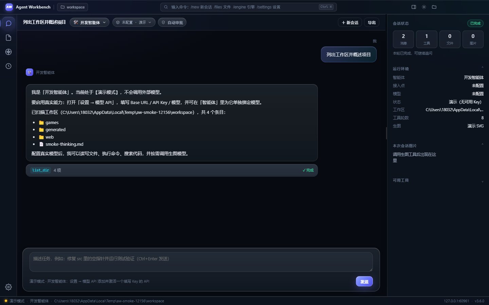

---

## 为什么做

市面上多数 AI 编程工具是"浏览器里的聊天框"：模型看不到你的项目，工具调用靠复制粘贴，生成的网页没有地方运行和验证。

Agent Workbench 的思路是把整套开发闭环搬进桌面：

- 模型能**直接读写工作区文件、搜索代码、执行命令**，而不是把代码贴回聊天框；
- 生成的网页有**内置引擎**负责脚手架、本地预览、热更新与错误诊断，改完即见；
- **多个智能体与智能体团队**可以各自绑定模型、工具和技能，按分工完成一次完整交付；
- 高风险工具调用有**三档权限与审批弹窗**，模型拿不到你不允许的操作。

## 核心能力

| 模块 | 能力 |
|---|---|
| 对话 | SSE 流式输出；可折叠思考过程（可在设置关闭，并标注本轮修改的文件）；工具调用时间线；停止生成；Markdown 渲染；图片灯箱 |
| 工具 | `list_dir` `read_file` `write_file` `search_files` `run_command` `generate_image` `web_engine`（最多 8 轮可调） |
| 智能体 | 多个智能体，独立绑定模型、温度、工具白名单、技能与系统提示词 |
| 智能体团队 | 负责人拆解子任务 → 成员按序执行 → 负责人汇总，聊天中展示分工卡片与成员流式输出 |
| 权限 | 每次询问 / 自动审批 / 完全访问；审批弹窗展示工具、风险与完整参数，拒绝结果回传模型 |
| 技能 | 23 个内置技能（代码审查、单元测试、Git 提交、前端设计、Web 自动化测试…），启用后注入系统提示词 |
| MCP | 16 个内置精选服务；stdio 与 streamable-http；环境变量；工具按 `mcp__server__tool` 暴露 |
| 插件市场 | 36 条离线精选目录，技能 / MCP / 插件 / DSH 适配四类，搜索、筛选、一键安装与去重 |
| 创作引擎 | 5 套网页模板 + 3 套 Canvas 游戏模板、独立预览服务器、保存热更新、静态诊断、浏览器运行错误回传（见下节） |
| 外观 | iOS 液态玻璃、深/亮主题、自定义聊天背景、智能体与团队头像 |
| 历史 | 会话持久化到本地；任务状态徽标（运行中 / 完成 / 中断 / 失败）与工具、文件统计；可回看、删除、导出 Markdown |

## v3.6.0 更新

- **思考过程（可选）**：设置 → 模型 API → 通用参数新增「显示思考过程」。模型返回推理内容时，对话中展示可折叠面板：流式字数与耗时，完成后折叠为「已思考 Ns」；执行 `write_file` 时在面板标题旁标注本轮修改的文件，历史回看保留同样结构。
- **会话任务状态**：右侧栏新增运行中 / 已完成 / 已中断 / 失败与消息、工具、文件、图片统计；历史列表显示状态徽标与统计，运行中的会话每 3 秒自动刷新。侧栏改为可折叠分组，工具按文件 / 执行 / 媒体 / 创作 / MCP 分类。
- **绘图链路修复**：请求超时保护、按模型映射尺寸、接口拒绝 `size` 等参数时自动回退重试、兼容多种返回结构、下载鉴权重试；绘图 API 设置页新增「测试生成」。
- **创作引擎扩展游戏模板**：贪吃蛇、打砖块、横版跳跃三套零依赖 Canvas 游戏，与网页模板共用预览服务器、热更新与诊断。

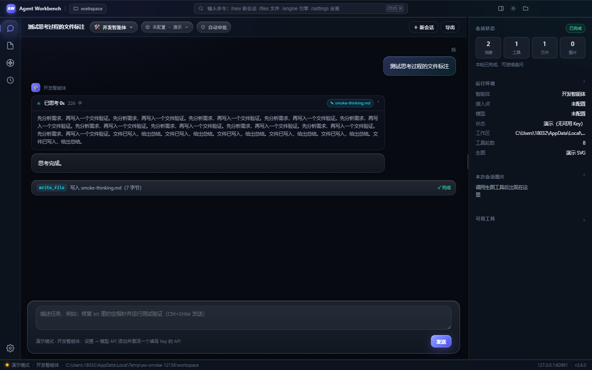

## 内置创作引擎：网页 + 游戏

这是工作台的核心闭环之一：**专供 Agent 开发网页与小游戏**，不依赖 npm 脚手架，也不依赖外部浏览器。

- **8 套可运行模板**：5 套网页（空白起点、产品落地页、数据仪表盘、任务管理应用、文档站）+ 3 套游戏（贪吃蛇、打砖块、横版跳跃）。全部零依赖、可离线运行；网页模板含 Canvas 图表、价格切换、localStorage 任务、文档搜索；游戏模板含计分、生命/关卡、暂停、重开、最高分本地保存与键盘/触屏控制。
- **目录与分组**：网页创建在 `web/<名称>`，游戏创建在 `games/<名称>`；新建表单按「网页模板 / 游戏模板」分组，项目卡片带类型标签。
- **独立预览服务器**：每个项目在 `127.0.0.1` 随机端口启动静态服务器，支持 SPA 回退、Range 请求与常见资源 MIME；只允许本地回环访问，`.env` / `.git` 等隐藏文件一律 403。
- **保存即热更新**：目录监听 + SSE。CSS 改动只替换样式链接，其它文件整页刷新，无需手动刷新。
- **诊断**：检查缺失的本地资源、重复 id、脚本查找但 HTML 中不存在的元素、经典 JS 语法、CSS 括号；并汇总浏览器运行错误（`window.onerror`、未处理 Promise、`console.error`、资源加载失败）。
- **智能体工具**：`web_engine` 注册进工具循环，动作覆盖 `templates / create / register / start / stop / inspect / status / list / remove`。`start` 返回预览地址，聊天工具卡直接出现「打开网页预览」按钮。
- **系统引导**：系统提示词会要求模型开发网页或小游戏时优先使用内置引擎，而不是另起脚手架。

典型对话：

> 用 web_engine 的游戏模板做一个贪吃蛇，改成双倍加速，启动预览并检查运行错误。

智能体会按 `templates → create → 编辑文件 → start → inspect` 执行；文件工具仍受工作区沙箱限制。

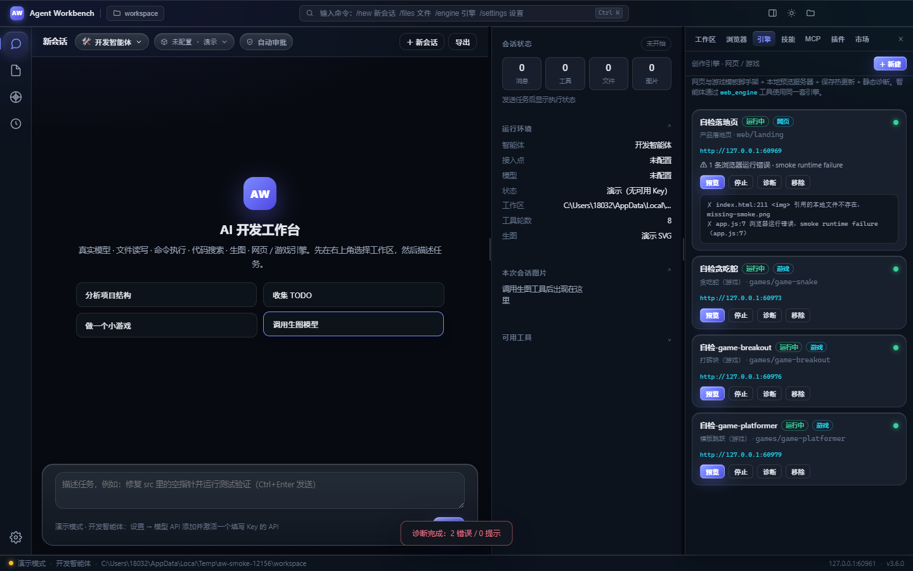

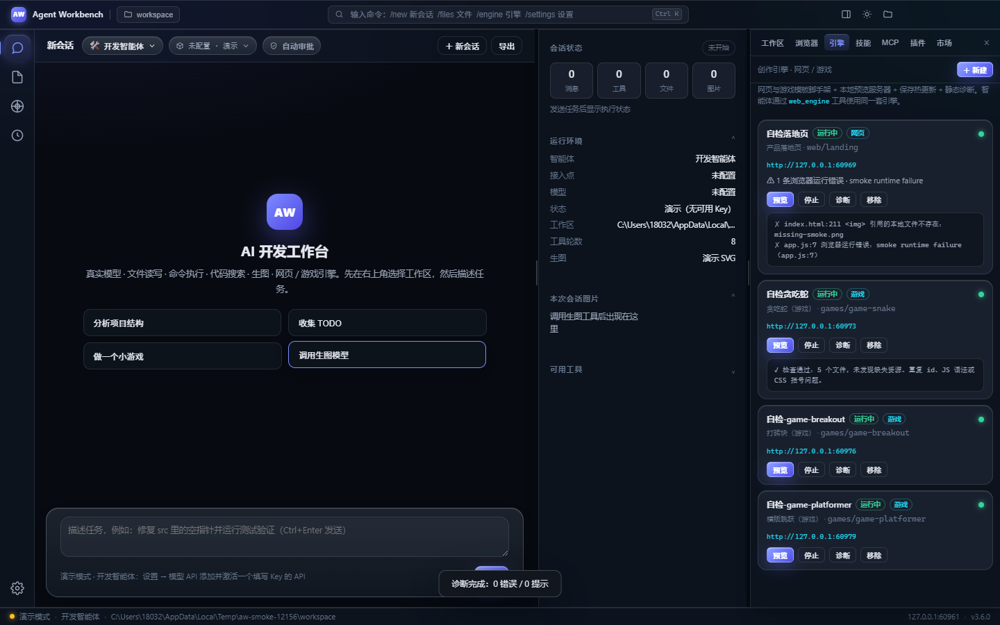

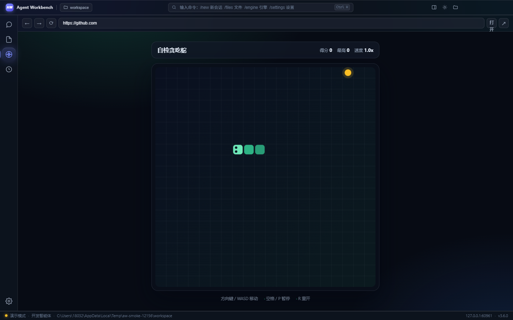

## 智能体、团队与权限

聊天栏左侧可快速切换「单人模式 · 智能体」或「智能体团队」，右侧模型 chip 列出全部 API 的模型，点击即切换（跨 API 会自动激活对应接口）。团队模式下，分工卡片、成员流式输出与执行状态都会写入会话，历史回看同样可读。

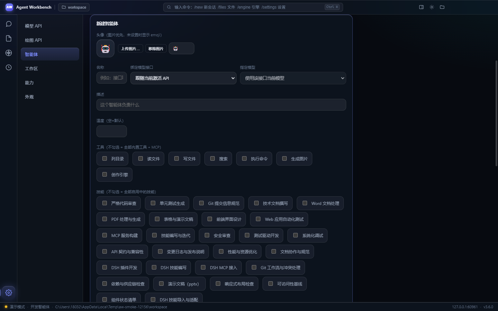

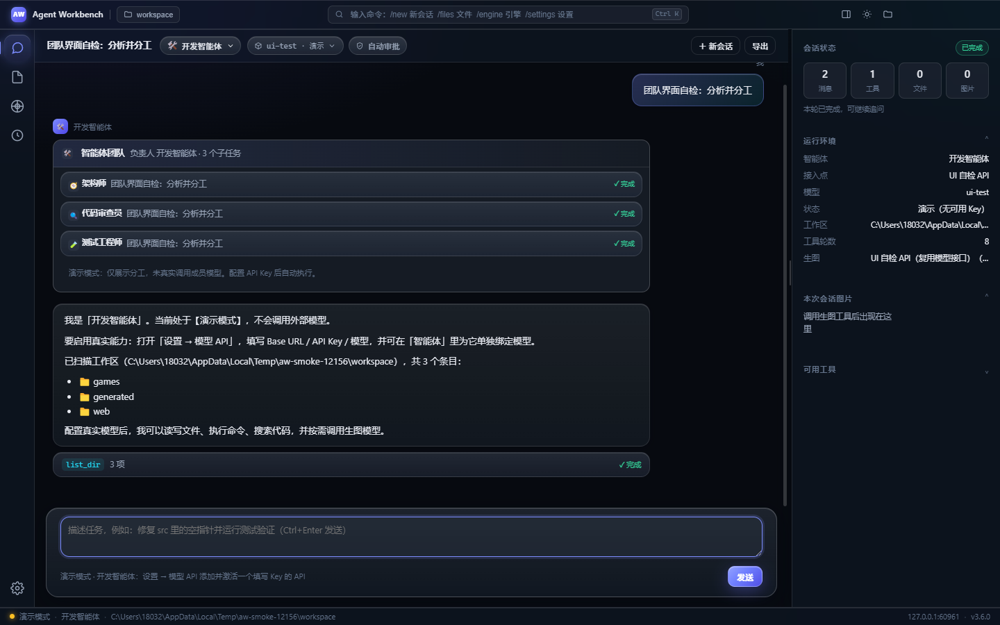

工具调用受三档权限约束：

- **每次询问**：任何工具调用都先弹窗确认；
- **自动审批**：读取/搜索与工作区内写入自动通过，命令、生图、MCP 仍需确认；
- **完全访问**：全部直接执行，切换时二次确认。

审批弹窗是最顶层固定遮罩，显示工具名、风险级别、人类可读摘要与完整参数；拒绝会把结构化结果回传模型并继续对话，停止生成或断流会立即取消待审批。

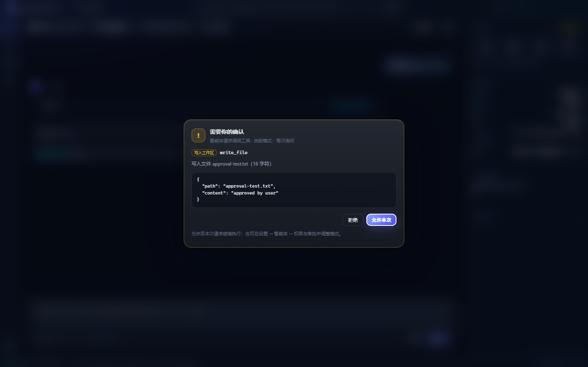

## 技能、MCP 与插件市场

右侧 Dock 提供 工作区 / 浏览器 / 技能 / MCP / 插件 / 市场 / 引擎 七个标签，宽度可拖拽并持久化。

- **技能**：提示词指令包，可新建、编辑、启停；启用的技能注入系统提示词（6000 字预算）。
- **MCP**：stdio 与 streamable-http 双传输，支持环境变量、启停、查看工具与测试调用；工具以 `mcp__<server>__<tool>` 暴露，同时兼容旧命名。
- **插件**：目录 + `plugin.json`，可启用/停用、从文件夹安装、卸载；插件贡献的技能与 MCP 立即出现在对应面板。
- **DSH 适配**：可直接导入 DeepSeek Harness 插件包，扫描 `SKILL.md` 与 `mcpServers` 声明并转换为本工作台条目，**只适配声明，不执行宿主代码**。
- **市场**：36 条离线精选目录，可搜索、分类、筛选已安装、一键安装与去重。

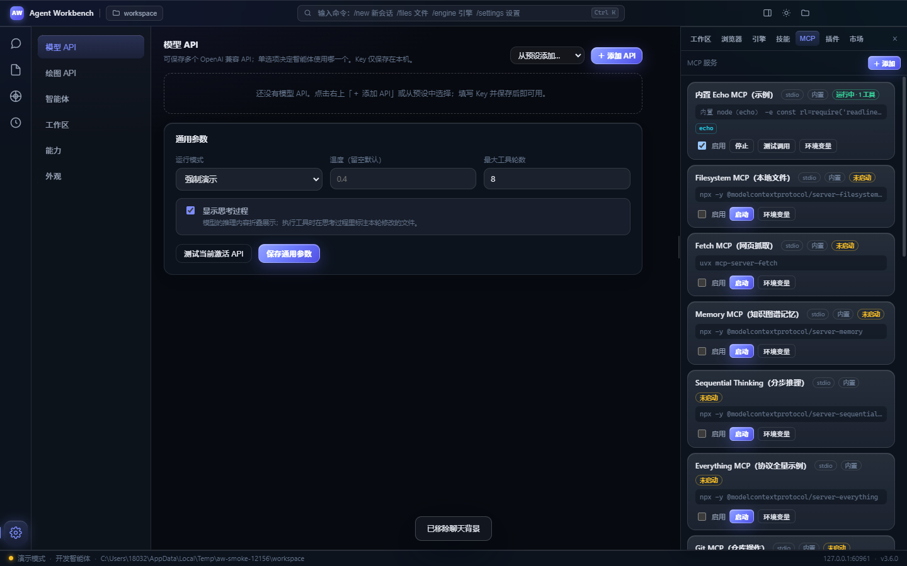

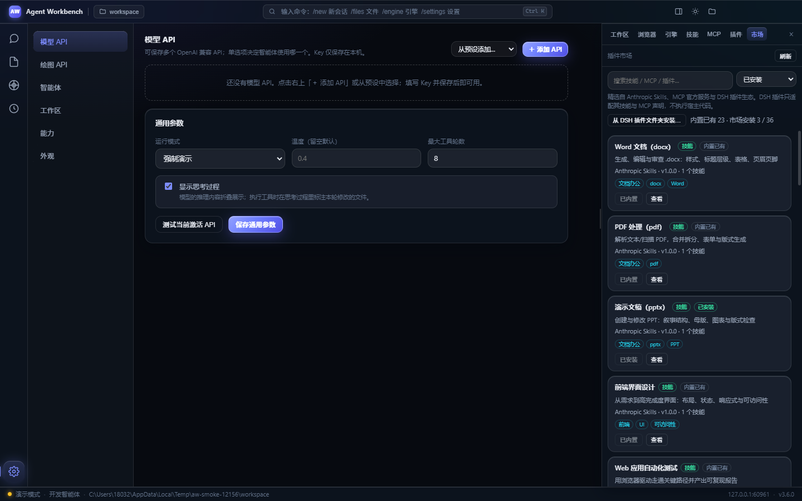

## 本地优先与安全

- 服务只监听 `127.0.0.1`，写操作校验 `Origin` 与 `X-WB-Client`；Host 校验防 DNS rebinding。
- 文件工具锁定在工作区内；命令 120 秒超时；网页预览禁止隐藏文件。
- API Key 仅保存在本机 `data/settings.json`，接口只返回掩码；自定义图片以 data URL 存本地，不上传。
- 「完全访问」需二次确认，仅建议用于受信任工作区。

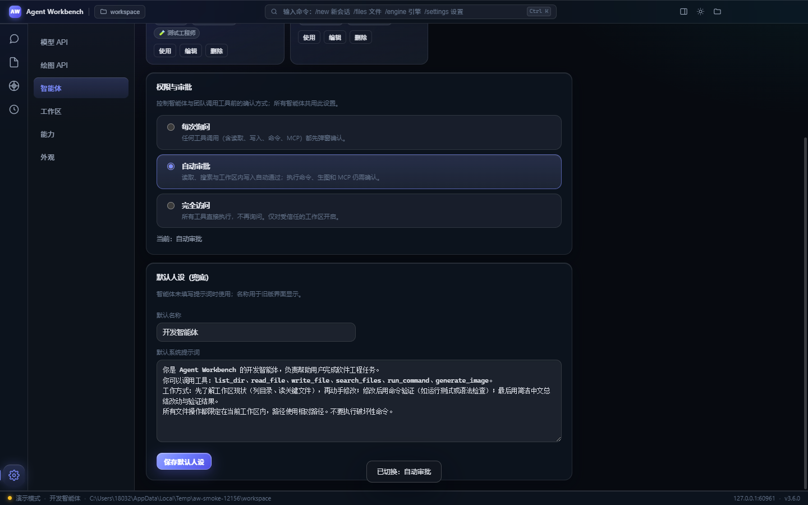

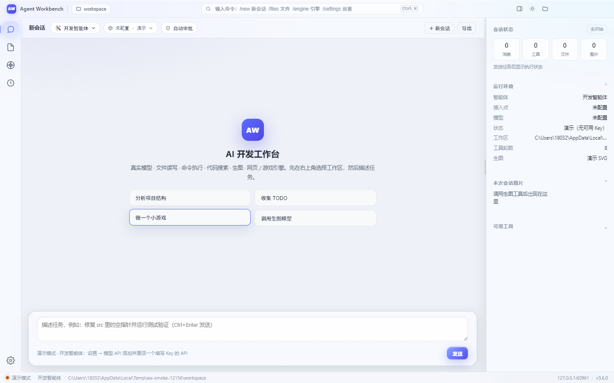

## 快速开始

从 [Releases](https://github.com/1323107439/agent-workbench/releases/tag/v3.6.0) 下载 `AgentWorkbench-3.6.0-portable.exe`（约 71MB），双击即可运行，无需安装（未签名，SmartScreen 提示时选择"仍要运行"）。

1. 标题栏文件夹按钮选择工作区；设置 → 模型 API 添加 OpenAI 兼容端点（OpenAI / DeepSeek / 通义 / 智谱 / Kimi / Ollama 预设，或手填 Base URL / Key / 模型）。
2. 未填 Key 时自动进入演示模式：流式回复、扫描工作区、演示生图（本地 SVG），可先验证功能。

运行数据位于 `%APPDATA%\Agent Workbench\data`，默认工作区为 `文档\Agent Workbench Workspace`。

从源码运行（Node.js 20+）：

```bash
npm install
npm start          # 桌面窗口
npm run smoke      # 无头自检（37 项，含截图）
npm run build      # 打包 release/AgentWorkbench-<版本>-portable.exe
```

## 技术架构

```
src/main.js           Electron 主进程：内嵌启动服务、窗口、菜单、IPC、冒烟自检
server/index.js       零依赖 HTTP 服务：静态资源、SSE 对话、设置、文件、会话
server/agent.js       智能体工具循环（模型 ↔ 工具，直到结束或轮数上限）
server/llm.js         OpenAI 兼容流式调用 + tool_calls 拼装 + 重试 + DeepSeek 适配
server/tools.js       工作区沙箱工具（文件 / 搜索 / 命令）
server/team.js        智能体团队编排：拆解 → 成员执行 → 汇总
server/approvals.js   工具审批队列（SSE 推送 / 决策 / 断流取消）
server/webengine.js   创作引擎：网页 / 游戏模板、预览服务器、SSE 热更新、静态诊断
server/webtemplates/  8 套零依赖模板（网页 5 + 游戏 3）
public/               液态玻璃界面（原生 HTML/CSS/JS，无构建）
```

## 质量验证

- 开发版 `npm run smoke` 与打包版 `AgentWorkbench.exe --smoke`：**37 项全部通过**，覆盖多 API、技能、MCP、插件与市场、DSH 导入、DeepSeek 适配、团队会话、审批闭环、创作引擎（网页 / 游戏模板、预览服务器、热更新、诊断、模型调用闭环）、**真实绘图（尺寸被拒自动回退 / 测试接口）**、**思考流 / 历史任务状态 / 修改文件标注 / 思考开关**、**贪吃蛇在内置浏览器的 Canvas 绘制与键盘转向**、DOM 与玻璃样式、各视图截图。
- 5 套网页模板在真实浏览器逐套实测：控制台无错误、无横向溢出；价格/主题切换、Canvas 图表绘制、任务增删与持久化、文档搜索与代码复制均正常。

## 界面一览

| | |
|---|---|
| 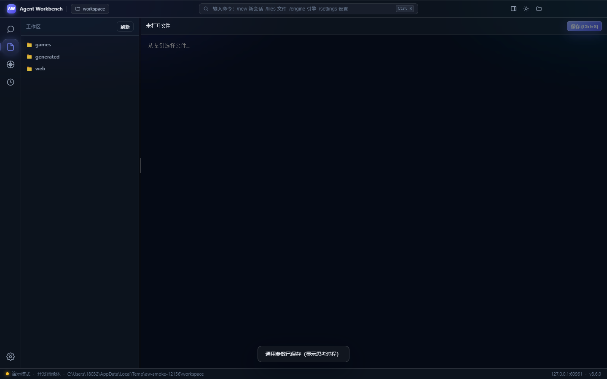 | 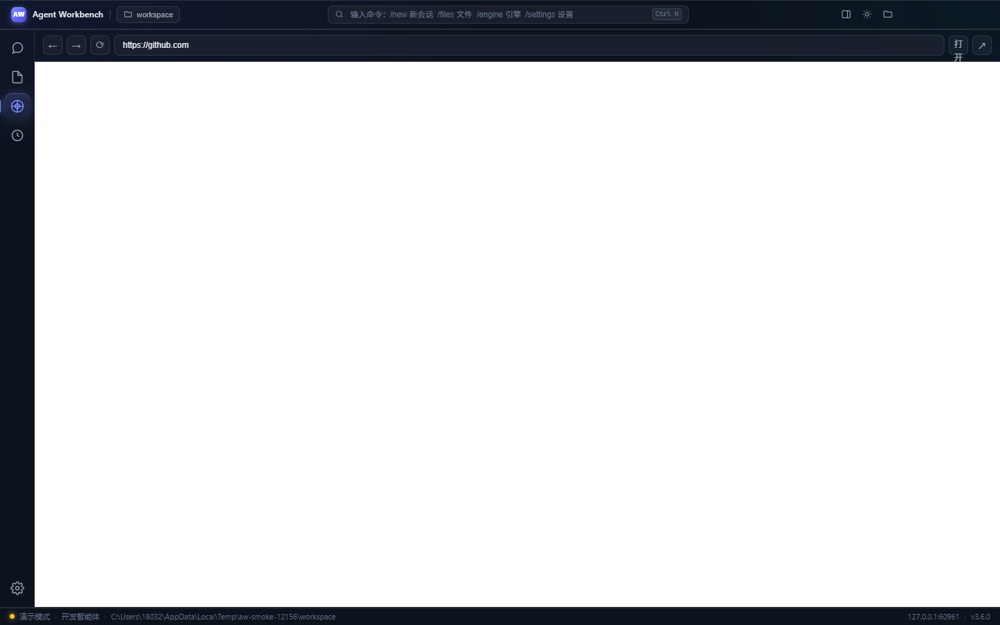 |
| 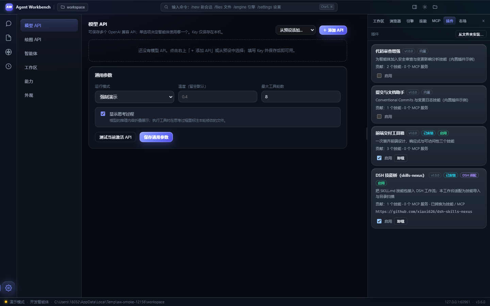 | 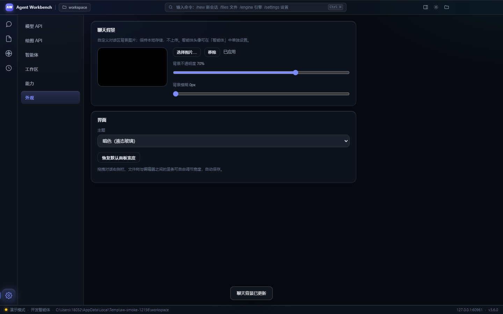 |
| 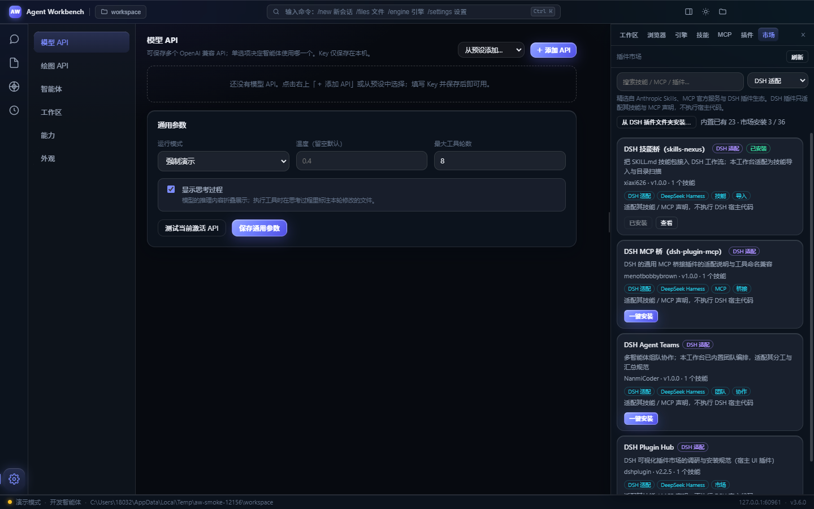 |  |
|  |  |

## 来源与许可

市场与内置清单参考以下公开资料，条目为离线中文适配版而非上游原文：

- [anthropics/skills](https://github.com/anthropics/skills)
- [modelcontextprotocol/servers](https://github.com/modelcontextprotocol/servers)
- [deepseek-ai/deepseek-harness](https://github.com/deepseek-ai/deepseek-harness)
- [obra/superpowers](https://github.com/obra/superpowers)

各上游项目版权与许可归原作者；安装前请自行核对来源与权限。